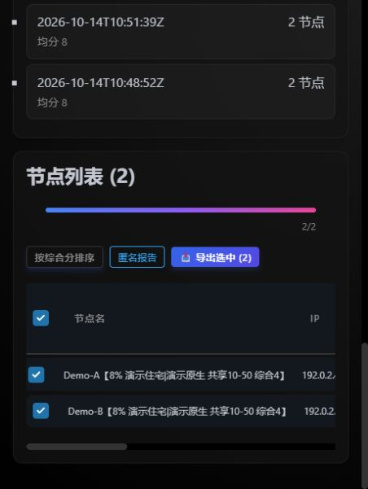

# 验证记录

## 0.1.1：双击直接检测（2026-10-15）

- 核对用户原有桌面快捷方式：最终运行 `one_click_check.py --unlock`。新版两个双击入口与之对齐，不启动 Web。
- Windows / Python 3.12 本地 `python -m pytest -q`：166 项通过。
- 真实首次启动验证：从无虚拟环境的源码副本开始，路径包含空格，从其他工作目录执行中文 `.cmd --help`，自动创建环境并安装 CLI 依赖，退出码 0。
- 在该全新环境成功导入 CLI 与独立订阅 HTTP 处理器，确认没有 FastAPI / Starlette；帮助命令未生成历史或导出，也未启动真实扫描。
- 新增 CI 首次启动检查。实际 CI 结果以对应提交的 Actions 为准。

以上验证证明入口与安装链路，不代替本次真实订阅扫描、账号登录或外网可用性验证。

## 0.1.0：首次公开版本

2026-10-14，首次开源准备。

| 层次 | 已执行内容 | 证据边界 |
| --- | --- | --- |
| 原版基线 | 18 个原有测试脚本逐一通过 | 仅本地原版回归，不代表外部站点当前判定准确。 |
| 新版离线与 HTTP | Windows / Python 3.12，`python -m pytest -q`：160 项通过 | 模拟响应、临时文件、假控制器和真实回环 HTTP；不使用正在运行的 Clash。 |
| 完整 API 流程 | start → SSE → report → recheck → export → stable subscribe | 假控制器；验证凭据过滤、报告匿名化、真实 YAML 保留与原分组选择恢复。 |
| 真实浏览器 | 页面加载、无效订阅拦截、模拟 2 节点完成、匿名报告下载、导出弹窗和稳定 URL | 演示模式，全为模拟数据，不证明真实外网可用性。未触发导入 Clash。 |
| 窄窗口 | 浏览器视口 452px，页面宽 452px；结果表宽 1192px，局部滚动区 386px | 当前窗口实测，不代表所有浏览器和设备。 |
| 依赖 | `python -m pip check` 通过 | 依赖一致性检查，不等于全面漏洞审计。 |
| 公开内容 | `python scripts/check_release.py` | 检查跟踪文件、已知凭据模式、本地文档链接、许可与资源哈希；不是任意敏感信息的绝对保证。 |

GitHub 首轮自动检查 [38553156998](https://github.com/tasuma-qwq/nodescope/actions/runs/38553156998) 已全部通过：Windows / Linux × Python 3.10 / 3.12，提交 `836e7ef`。后续提交以 [Actions](https://github.com/tasuma-qwq/nodescope/actions/workflows/tests.yml) 实际结果为准。

Windows 新手入口 `start.cmd` 已在本机实际启动，首页 HTTP 200，品牌为 NodeScope、非演示模式，响应含 `Cache-Control: no-store`。原始项目工作区保持干净。公开仓库首轮核对共 97 个文件，未包含运行目录和配置；GitHub 正确识别 AGPL-3.0，已启用私密漏洞报告。

未执行：用户正在使用的 Clash 会话、真实全订阅扫描、真实账号登录 / 模型调用、macOS 设备实测、公网部署、生产环境验证。原有真实环境记录没有复制到本仓库，不能作为本次发布的实测证据。

当前测试依赖组合会出现一条 Starlette 关于未来迁移 `httpx2` 的弃用提示，不影响上述断言；没有屏蔽该提示。

## 演示与截图

无需真实代理即可试用界面：

```bash
python scripts/preview_demo.py
```

打开 `http://127.0.0.1:8081`，粘贴 `examples/demo.yaml.example`。演示使用文档保留 IP，所有检测结果为明确标注的模拟值；不会连接 Clash 或外部探针。停止演示后再运行 `web.py` 使用真实入口。

下图是模拟数据验证截图，不能当作真实 IP 检测结果：


